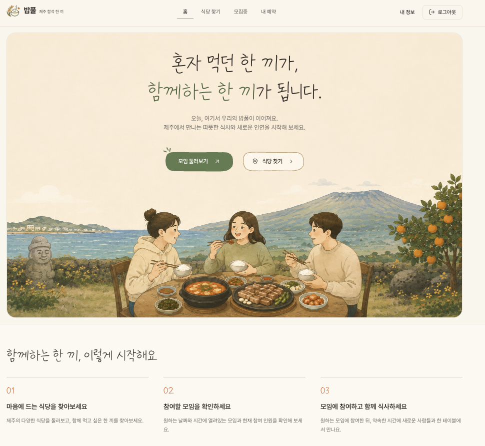
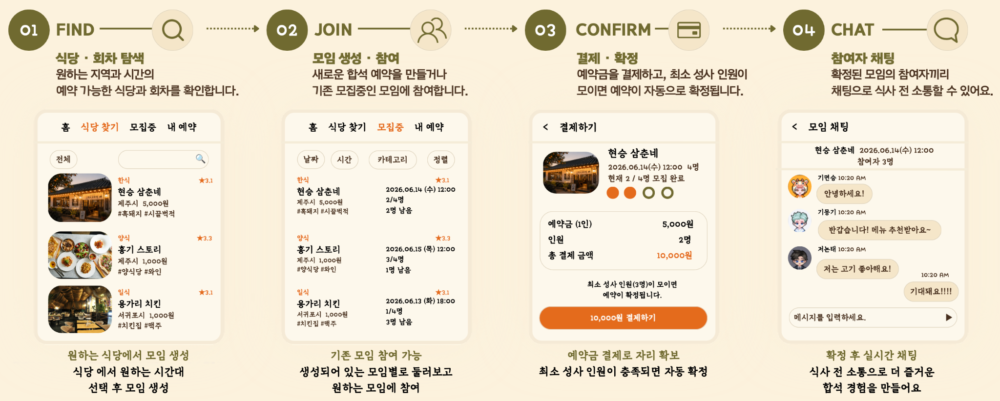

# 🍚 BobFull | 제주 합석 예약 플랫폼

> **혼자 온 여행객과 식당의 빈 좌석을 연결하는 좌석 단위 합석 예약 서비스**

BobFull(밥풀)은 제주에서 혼자 여행하는 사용자가 식당과 예약 가능한 시간대를 탐색하고, 다른 여행객과 함께 식사할 모임을 만들거나 참여할 수 있는 플랫폼입니다. 예약금 결제부터 합석 확정, 참여자 채팅까지 하나의 흐름으로 연결했습니다.

**이 저장소는 4인 팀 프로젝트를 기반으로 개인적으로 코드 구조를 정리하고 AI 검수 기능을 고도화한 백엔드 저장소입니다.** 원본 프로젝트의 공동 작업과 이후 개인 작업은 아래에 구분했습니다.

[팀 프로젝트 원본](https://github.com/bobfull-project/bobfull-backend) | [Frontend](https://github.com/bobfull-project/bobfull-frontend) | [기술 문서](https://github.com/bobfull-project/bobfull-docs) | [System Flow](https://bobfull-project.github.io/bobfull-docs/100-learning/system-flow/v3/operations-system-flow/) | [발표자료](https://drive.google.com/file/d/1erg_wEFZdVDT4VQ8qKs5CZ_1iz2MIUQx/view?usp=sharing)

---

## 01. 프로젝트 소개

| 항목 | 내용 |
| --- | --- |
| 프로젝트 | BobFull (밥풀) |
| 팀 프로젝트 기간 | 2026.07.21 ~ 2026.08.24 |
| 구성 | 내일배움캠프 최종 프로젝트, 4인 |
| 대상 | 제주에서 혼자 여행하는 사용자와 식당 운영자 |
| 주요 기능 | 식당 검색, 합석 모집 및 예약, 예약금 결제, 실시간 채팅 |
| 수상 | 우수상 |

### 해결하려는 문제

- **여행객:** 혼자 방문하기 부담스러운 식당, 2인 이상 주문 제약, 함께 식사할 사람을 찾기 어려운 문제
- **식당:** 테이블 단위 운영에 따른 빈 좌석, 예약 취소와 노쇼 관리 부담

BobFull은 개별 좌석 단위로 합석을 모집하고 예약금과 참여 상태를 관리해 여행객과 식당의 문제를 함께 해결하고자 했습니다.



### 팀 구성과 담당 역할

| 구성원 | 역할 | 주요 담당 |
| --- | --- | --- |
| 김현승 | 팀장 | 결제 및 환불, 정산, AI 및 채팅 |
| **김홍기** | **부팀장** | **합석 테이블, 예약 시간, 검색 API, AWS 배포 및 모니터링** |
| 배지현 | 발표 | 예약, 좌석 재고 동시성, Kafka, 프론트엔드 |
| 정용태 | 서기 | 회원 및 인증, 식당 및 관리자, 캐시, 성능 테스트 |

---

## 02. 주요 기능 및 이용 흐름

서비스는 **식당 탐색 → 모임 생성·참여 → 예약금 결제 및 합석 확정 → 참여자 채팅**으로 이어집니다.



| 단계 | 사용자가 할 수 있는 일 | 백엔드의 주요 처리 |
| --- | --- | --- |
| **01 FIND** | 지역, 날짜, 시간 등으로 식당과 회차 탐색 | QueryDSL 동적 검색, Redis 반복 조회 캐시 |
| **02 JOIN** | 합석 모임을 생성하거나 모집 중인 모임에 참여 | 예약 가능 인원 조회, 좌석 선점 및 동시성 제어 |
| **03 CONFIRM** | 예약금 결제 후 예약 상태 확인 | PortOne 결제 검증, 최소 성사 인원에 따른 확정, 취소 및 환불 |
| **04 CHAT** | 확정된 합석 참여자와 대화 | WebSocket/STOMP, Redis Pub/Sub, 메시지 저장 및 AI 검수 |

그 밖에 식당 운영자를 위한 예약 관리, 지급 예정 예약금 조회와 관리자 운영 기능을 제공합니다.

[서비스 정책 및 상태 전이](docs/010-product/project-context.md) | [전체 API 명세](docs/020-api/bobfull-api-spec-complete.md) | [실제 백엔드 처리 흐름](https://bobfull-project.github.io/bobfull-docs/100-learning/system-flow/v3/operations-system-flow/)

---

## 03. 시스템 아키텍처

팀 프로젝트의 **최종 AWS 배포 및 검증 기준** 아키텍처입니다.


| 영역 | 주요 구성 | 설계 의도 |
| --- | --- | --- |
| API 및 배포 | AWS ALB, EC2, GitHub Actions, ECR, SSM | Blue-Green 트래픽 전환 및 배포 중 요청 처리 |
| 데이터 및 캐시 | RDS for MySQL, ElastiCache for Valkey | 영속 데이터 보관, 반복 검색 캐싱 및 서버 간 채팅 전파 |
| 비동기 처리 | Transactional Outbox, Kafka | 핵심 거래와 AI 등 후속 처리의 실패 경계 분리 |
| 관측 및 알림 | Prometheus, Grafana, CloudWatch, Slack | 운영 지표, 로그 및 장애 알림 확인 |

> **검증 범위:** 무중단 배포와 다중 인스턴스 검증은 Application Layer 기준입니다. 당시 RDS는 Single-AZ, Kafka는 단일 Broker였으므로 전체 시스템의 고가용성을 달성했다고 표현하지 않습니다.

[아키텍처 상세 문서](https://github.com/bobfull-project/bobfull-docs/blob/main/architecture/system-architecture.md)

---

## 04. 기술 스택

| 영역 | 기술 |
| --- | --- |
| Backend | Java 17, Spring Boot, Spring MVC, Spring Security, JPA, QueryDSL |
| Database / Cache | MySQL, Amazon RDS, Redis, ElastiCache for Valkey |
| Event / Realtime | Kafka, Transactional Outbox, WebSocket/STOMP, Redis Pub/Sub |
| AI / External | Spring AI, OpenAI, PortOne |
| Infra / DevOps | AWS EC2, ALB, ECR, SSM, Docker, GitHub Actions |
| Monitoring / Test | Prometheus, Grafana, CloudWatch, JUnit 5, Testcontainers, k6 |
| Frontend (팀 프로젝트) | React, TypeScript, Vite, Tailwind CSS |

정확한 의존성 버전과 개발 환경 설정은 [`build.gradle`](build.gradle), [Gradle Wrapper](gradle/wrapper/gradle-wrapper.properties), [Docker Compose](docker-compose.yml)에서 확인할 수 있습니다.

---

## 05. 주요 문제 해결 및 검증 결과

아래는 **팀 프로젝트 당시 공동으로 구현하고 검증한 대표 결과**입니다. 측정값은 각 실험의 조건에서 관측된 값이며, 모든 운영 환경에 동일하게 적용된다는 의미는 아닙니다.

| 검증 대상 | Before → After / 결과 | 핵심 판단 |
| --- | --- | --- |
| 인기 회차 조회 | **쿼리 83 → 7**, 고부하 p95 **13.14s → 1.34s** | 회차별 반복 조회를 묶음 조회로 전환 |
| 정산 조회 | p95 **6.5s → 30.32ms**, Hikari 대기 **92 → 0** | Batch보다 Query 및 Index 개선 선택 |
| 반복 식당 검색 | p95 **43ms → 14ms**, DB 쿼리 **2 → 0** | 정합성 영향이 낮은 조건에 캐시 적용 |
| Kafka AI 처리 | 완료 시간 **15.616s → 7.271s** | Partition Key 변경으로 병렬 처리 개선 |
| Blue-Green 배포 | 외부 요청 **2,787 / 2,787 성공**, 관측 중단 **0s** | ALB 기반 애플리케이션 트래픽 전환 검증 |
| Outbox 후속 처리 | Async **5.394s**, Kafka **7.210s** | 속도가 아니라 격리, 적체 복구, Retry/DLT 기준으로 Kafka 유지 |

<details>
<summary><strong>대표 Case Studies 및 상세 근거 보기</strong></summary>

| 문서 | 주제 |
| --- | --- |
| [CS-01](https://github.com/bobfull-project/bobfull-docs/blob/main/case-studies/cs-01-spof-to-multi-az-blue-green.md) | 단일 EC2 장애 지점에서 다중 App 및 Blue-Green 구조까지 |
| [CS-02](https://github.com/bobfull-project/bobfull-docs/blob/main/case-studies/cs-02-query-index-to-settlement-optimization.md) | 검색 및 정산 조회 성능 병목 분석 |
| [CS-03](https://github.com/bobfull-project/bobfull-docs/blob/main/case-studies/cs-03-transaction-and-followup-failure-boundary.md) | 거래와 후속 작업의 실패 경계 |
| [CS-04](https://github.com/bobfull-project/bobfull-docs/blob/main/case-studies/cs-04-ai-moderation-optimization.md) | AI 검수 호출과 우회 검수 개선 |
| [CS-05](https://github.com/bobfull-project/bobfull-docs/blob/main/case-studies/cs-05-outbox-async-vs-kafka.md) | Outbox + Async와 Kafka의 비교 |
| [CS-06](https://github.com/bobfull-project/bobfull-docs/blob/main/case-studies/cs-06-post-payment-processing-strategy.md) | 결제 이후 후속 처리 전략 선택 |

[전체 Case Studies](https://github.com/bobfull-project/bobfull-docs/tree/main/case-studies) | [실측 근거 및 조건](docs/110-records/evidence/v3/final-claim-matrix.md)

</details>

---

## 06. 개인 리팩토링 및 고도화

팀 프로젝트 종료 후 전체 백엔드 코드를 직접 분석하며 **구조와 책임을 정리하고, AI Moderation의 검수 품질과 호출 효율을 별도로 검증**하고 있습니다.

| 작업 | 주요 내용 | 기록 |
| --- | --- | --- |
| 1차 구조 리팩토링 | 기능별 패키지와 책임 및 소유권 정리, 코드 작성 기준 통일, 회귀 검증 | [리팩토링 검증 #38](https://github.com/gpekd5/bobfull-backend/issues/38) |
| AI Moderation 평가 | 정책과 고정 평가 데이터를 기준으로 오탐/미탐 및 위험도 판정 비교 | [Evaluation #48](https://github.com/gpekd5/bobfull-backend/issues/48) |
| LLM 호출 효율화 | Native 단건 처리와 Micro-batching의 Token, 비용, 품질 비교 | [효율화 실험 #56](https://github.com/gpekd5/bobfull-backend/issues/56) |
| Kafka Poll-Batch | 기존 Kafka 소비 흐름에 Batch 처리 구현, Retry/DLT 및 실제 연계 검증 | [구현 #59](https://github.com/gpekd5/bobfull-backend/issues/59), [실제 연계 검증 #68](https://github.com/gpekd5/bobfull-backend/issues/68) |

### AI Moderation 효율화 실험

별도 승인된 **비운영 Kafka → OpenAI → MySQL 연계 실험(480관측)**에서 단건 Native 처리 대비 Poll-Batch의 사용량을 비교했습니다.

| 실험 지표 | 관측 결과 |
| --- | --- |
| Total Token | **75.8% 감소** |
| 캐시 할인 반영 추정 비용 | **71.0% 감소** |
| 최종 기술적 판단 | Kafka Poll-Batch 선정 |
| 운영 적용 상태 | **Production Batch 기본 OFF, 품질 승인 보류** |

Token과 비용 절감은 **해당 비운영 실험 조건에서의 관측치**입니다. 품질 검증에서는 미탐 및 중요 위험도 하향 문제가 확인되어 운영 품질 유지가 입증되지 않았고, Batch의 운영 활성화도 승인되지 않았습니다.

[전체 효율화 판단 및 남은 과제 #55](https://github.com/gpekd5/bobfull-backend/issues/55) | [실제 Provider 연계 검증 #68](https://github.com/gpekd5/bobfull-backend/issues/68) | [LLM Observability #49](https://github.com/gpekd5/bobfull-backend/issues/49)

---

## 07. 로컬 실행

**필요 환경:** Java 17, Docker 및 Docker Compose

1. 로컬 설정 파일을 준비하고 환경값을 지정합니다.

```bash
cp .env.example .env
cp src/main/resources/application-local.yml.example src/main/resources/application-local.yml
```

2. MySQL, Redis, Kafka를 실행합니다.

```bash
docker compose up -d mysql redis kafka
```

3. Spring Boot 애플리케이션을 실행합니다.

```bash
SPRING_PROFILES_ACTIVE=local ./gradlew bootRun
```

Windows PowerShell:

```powershell
$env:SPRING_PROFILES_ACTIVE="local"
.\gradlew.bat bootRun
```

전체 애플리케이션을 Docker로 실행하려면 `docker compose --profile app up --build -d`를 사용합니다. 외부 연동과 비밀값은 로컬 환경에 맞게 설정하고 저장소에 커밋하지 않습니다.

---

## 08. 기술 문서

README에서는 서비스와 핵심 결과를 소개하고, **설계 판단과 상세 검증 기록은 원본 문서 및 개인 포크의 `docs/`에 분리**했습니다.

| 문서 | 내용 |
| --- | --- |
| [System Architecture](https://github.com/bobfull-project/bobfull-docs/blob/main/architecture/system-architecture.md) | 팀 프로젝트의 AWS 배포 아키텍처 |
| [Case Studies](https://github.com/bobfull-project/bobfull-docs/tree/main/case-studies) | 대표 문제 해결 사례 |
| [ADR](https://github.com/bobfull-project/bobfull-docs/tree/main/adr) | 주요 Architecture Decision Record |
| [Technical Decisions](https://github.com/bobfull-project/bobfull-docs/tree/main/decisions) | 구현 및 설계 의사결정 |
| [Troubleshooting](https://github.com/bobfull-project/bobfull-docs/tree/main/troubleshooting) | 개별 오류와 장애 대응 |
| [Performance](https://github.com/bobfull-project/bobfull-docs/tree/main/performance) | 성능 검증 결과 |
| [Engineering Records](https://github.com/bobfull-project/bobfull-docs/tree/main/engineering-records) | 배포, 운영 및 모니터링 개선 이력 |
| [System Flow](https://bobfull-project.github.io/bobfull-docs/100-learning/system-flow/v3/operations-system-flow/) | 백엔드 요청 처리 흐름 탐색 |

<details>
<summary><strong>개인 포크의 주요 기준 문서와 프로젝트 구조 보기</strong></summary>

| 기준 문서 | 내용 |
| --- | --- |
| [프로젝트 정책](docs/010-product/project-context.md) | 사용자 역할과 상태 전이 |
| [API 명세](docs/020-api/bobfull-api-spec-complete.md) | HTTP API 계약 |
| [ERD](docs/030-data/erd.md) | 데이터 모델 |
| [논리 아키텍처](docs/040-architecture/architecture.md) | 기능 및 책임 경계 |
| [도메인 의존성](docs/040-architecture/domain-dependencies.md) | 도메인 간 의존 관계 |
| [Backend ADR](docs/040-architecture/adr/README.md) | 개인 포크에 포함된 의사결정 기록 |
| [프로젝트 구조](docs/040-architecture/project-structure.md) | 패키지, 운영 도구 및 문서의 위치 |
| [Evidence Index](docs/110-records/evidence/v3/README.md) | 실험 및 회귀 검증 자료 |
| [Final Claim Matrix](docs/110-records/evidence/v3/final-claim-matrix.md) | 기존 팀 프로젝트 실측 주장과 근거 |
| [AI Workflow](docs/060-ai/workflow/ai-workflow.md) | AI 구현 보조와 Human Review 기준 |

```text
src/        Spring Boot 애플리케이션과 테스트
lambda/     독립 배포 Lambda 코드
ops/        배포, 모니터링, 부하 테스트 및 도구
docs/       제품, API, 설계, 개발 및 검증 문서
.github/    GitHub Actions와 Issue/PR 템플릿
```

</details>

### AI를 활용한 개발 방식

```text
Issue → AI Implementation → Human Review → PR Checklist → Feedback → Merge
```

AI는 구현과 문서 작성을 보조하지만, 정책과 트랜잭션 경계, 권한 및 보안, 성능 수치의 최종 판단은 실제 코드와 테스트 근거를 기준으로 검토합니다.

[원본 팀 프로젝트](https://github.com/bobfull-project) | [기술 문서 전체](https://github.com/bobfull-project/bobfull-docs) | [개인 개선 이력](https://github.com/gpekd5/bobfull-backend/issues)
