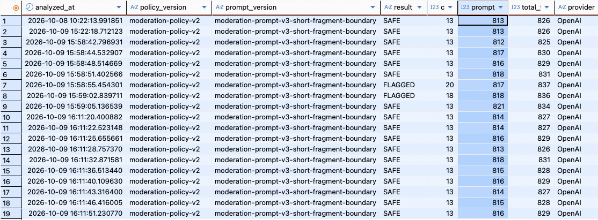

# Issue #55 AI Moderation LLM Efficiency Evidence

## 검증 대상

Issue #55의 초기 실험은 AI Moderation 품질을 먼저 고정한 뒤, LLM 호출당 반복되는 입력 token과 호출
구조를 근거로 효율화 후보를 비교했다. 이 README의 Before 및 Prompt A/B/C/D 실험에서는 Production
Prompt, Rule, model, output cap과 production 호출 구조를 변경하지 않았고, 후보는 test source에서만
독립 비교했다. 이후 Micro-batching 독립 평가와 기본 OFF Kafka Poll-Batch 구현은 별도 단계다.

### 단계와 Issue 구분

| 단계 | 관리 Issue | 범위 |
|---|---|---|
| Before / Prompt 경량화 / 후보 선정 / Token·비용 비교 | [#56](https://github.com/gpekd5/bobfull-backend/issues/56) | 이 README와 독립 Micro-batching 비교 Evidence |
| 반복성 / 요청 형식 / Batch 크기 / 순서·구성 | [#57](https://github.com/gpekd5/bobfull-backend/issues/57) | 진단 Dataset을 사용한 독립 평가 |
| Batch Checklist / 공통 Prompt Q1 | [#58](https://github.com/gpekd5/bobfull-backend/issues/58) | 두 개선 후보의 미채택 근거, 신규40건은 Human GT 미확정 초안 |
| Kafka Poll-Batch 구현 / 장애 복구 | [#59](https://github.com/gpekd5/bobfull-backend/issues/59) | Production 코드 변경을 포함하지만 Batch 기본 OFF, Fake/Kafka·DB 무과금 검증 |

#55는 상위 Tracker다. #59의 구현·복구 검증은 독립 평가의 품질·Token 측정과 다르며, 운영 활성화나
실제 OpenAI를 연결한 Kafka E2E 검증 완료를 뜻하지 않는다. Production Prompt/Policy/Rule은 유지했다.

전체 조사 흐름은 다음과 같다.

```text
Issue #48 Policy v2 Evaluation 품질 계약
→ Issue #49 LLM Observability
→ local DB에서 실제 OpenAI 호출별 token 반복 패턴 관측
→ Issue #55 재현 가능한 Before Baseline
→ 효율화 후보의 효과·위험 비교
→ 한 번에 하나씩 실험할 우선순위 결정
```

## 문제 발견 배경

Issue #49의 로컬 Dashboard와 `chat_moderation` 조회에서 OpenAI 호출 19건의 prompt token이
`812~821`, total token이 `825~837` 범위에 반복됐다. 이 결과와 현재 코드가 Rule miss마다 같은 System
Prompt와 Structured Output 계약을 다시 보내는 구조를 함께 보고, 고정 context와 호출 구조를 효율화 후보로
분석하기 시작했다.



위 이미지는 **효율화 문제를 발견한 관측 Evidence**다. local 수동 관측의 19개 row이며, 이미지에 표시된
`analyzed_at`은 2026-10-08~09다. 이는 DB의 분석 시각으로, 캡처 촬영 시각이나 문서 기록 시각과 같다고
간주하지 않는다. 정확한 촬영 시각은 확인되지 않았다. production/AWS 표본이나 입력 Dataset과 실행
조건을 고정한 #55 공식 Before/After Baseline이 아니다.

| Local manual observation | 값 |
|---|---:|
| OpenAI calls | 19 |
| Input / Output / Total token | 15,496 / 259 / 15,755 |
| Prompt token / call | 812~821 |
| Total token / call | 825~837 |
| Failure / Kafka Retry | 0 / 0 |

이미지 원본은 위 상대 경로로 보존한다. GitHub에서 연결할 때는 실제 push된 branch/path를 확인하고,
로컬 파일 경로나 추측한 원격 URL을 사용하지 않는다.

## 측정 계약

### 고정 조건

- Before SHA: `339423fbca943d578bf07793ff336490904290eb`
- Branch: `feature/55-ai-moderation-efficiency`
- 실행일: 2026-10-13 KST
- 실행 위치/profile: Human local / `local`
- Evaluation DB: H2 in-memory, MySQL mode
- Primary Dataset: Policy v2 Held-out 80
- Stability Dataset: Policy v2 고정 20건 × 3회
- Reference only: Historical Policy v1 Challenge 24
- Runtime policy: `moderation-policy-v2`
- Runtime prompt: `moderation-prompt-v3-short-fragment-boundary`
- Configured model alias: `gpt-4o-mini`
- Output cap: `128`
- 평가 route: 단일 메시지 `clearFlagged()` → Rule miss 시 실제 OpenAI Structured Output 호출
- API key 값, 원문 메시지와 사용자/채팅/메시지 식별자는 기록하지 않는다.

여기서 Before SHA와 실행 브랜치는 당시 측정 기준이다. 후속 raw JSON의
`339423fbca943d578bf07793ff336490904290eb + uncommitted test source`도 실행 당시 상태를 기록한 값이며,
이후 보존 Commit의 HEAD로 소급 교체하지 않는다. 현재 보존 Commit은 Git 이력과 PR Head에서 확인하고,
그 Commit 생성 시점에 과거 유료 실험을 다시 실행했다고 해석하지 않는다.

같은 SHA의 별도 단건 metadata 확인에서 Provider 응답 model은
`gpt-4o-mini-2024-07-18`이었다. 공식 136회 Baseline 하네스는 응답별 model을 결과 집계에 보존하지 않으므로,
136회 모두의 실제 snapshot을 독립적으로 확정한 값은 아니다.

### 품질 Guardrail

- Result Accuracy, Category Exact Accuracy, Review Actionability
- FLAGGED Precision / Recall / F1과 TP / FP / FN / TN
- category별 Precision / Recall / F1
- mismatch Case ID
- Rule / LLM route
- Provider / Parse / Validation failure

### 효율 지표

- logical LLM call 수와 Rule / LLM route
- 실제 HTTP attempt와 SDK retry
- prompt / completion / total token 합계와 호출당 평균·분포
- 공개 text token 단가 기반 Estimated Cost
- 평가 route latency와 Provider/HTTP/pipeline latency의 측정 경계

Candidate 실험은 동일 Dataset, policy, model alias, output cap과 실행 방식을 유지하고 변경 요소 하나만 바꾼다.
여러 후보를 채택할 때만 마지막에 조합 효과를 다시 측정한다.

## 기준 코드와 실제 호출 구조

Production 단일 메시지 흐름은 다음과 같다.

```text
ChatModerationService.analyze(messageId)
→ 완료 결과가 있으면 skip
→ ChatMessage 조회
→ ModerationRulePolicy.clearFlagged(content)
→ single Rule hit: Provider 호출 없이 저장
→ Rule miss: 최근 split 후보 확인
→ split Rule hit: Provider 호출 없이 저장
→ split Rule miss 또는 context 없음: 현재 message.content만 LLM에 전달
→ Structured Output 변환
→ Validation
→ ChatModeration 저장
```

`SpringAiModerationAdapter`의 요청은 매 logical call마다 아래 요소를 구성한다.

- System Prompt: `ModerationPrompt.SYSTEM_PROMPT`
- User message: 현재 `ChatMessage.content` 한 건
- Native Structured Output: `ModerationResult(result, categories, riskLevel)` JSON Schema
- Request option: `maxTokens=128`

Split context가 존재하더라도 split Rule에 적중하지 않으면 Provider에는 합친 context가 아니라 현재 메시지 한
건만 전달한다. `ModerationPrompt.withSplitContext()`는 과거/평가 코드에는 남아 있지만 현재 production LLM
경로에서는 사용하지 않는다.

애플리케이션 수준에서는 Rule miss 한 건당 logical LLM call이 한 번 발생한다. OpenAI SDK retry가 발생하면
이 한 logical call 안에서 HTTP attempt가 늘 수 있고, Kafka Consumer retry가 발생하면 저장 완료 전 동일
메시지의 logical call 자체가 다시 실행될 수 있다. 완료 상태 저장 뒤 재전달은 기존 완료 여부 검사로 skip한다.

## Before 품질 Baseline

### #48에서 재사용한 계약과 다시 실행한 항목

| 구분 | #55 처리 |
|---|---|
| Policy v1 Held-out/Challenge Dataset freeze와 SHA-256 | 기존 계약 재사용, 수정 없음 |
| Policy v2 ID 기반 Ground Truth override | 기존 계약 재사용, 수정 없음 |
| Held-out 80 / Stability 20×3 입력과 metric 정의 | 기존 계약 재사용 |
| Held-out 80 Provider 결과 | #55 Before SHA에서 실제 OpenAI 재실행 |
| Stability 20×3 Provider 결과 | #55 Before SHA에서 실제 OpenAI 재실행 |
| Challenge 24 | Historical Policy v1 참고값만 유지, 재실행하지 않음 |

Policy v1 Held-out 80과 Challenge 24의 canonical Dataset SHA-256은
`78a072fae2d208da79defeb9f7c260594f77c9e964f94d56e1615a55c840527e`다. Policy v2 Held-out은 같은
80개 ID/message/caseType을 유지하고 Human review로 확정한 15개 label override만 적용한다.

### Held-out 80 — 공식 #55 Before

| 지표 | 결과 |
|---|---:|
| N | 80 |
| Result Accuracy | 72/80 (90.0%) |
| Category Exact Accuracy | 72/80 (90.0%) |
| Review Actionability | 72/80 (90.0%) |
| FLAGGED Precision / Recall / F1 | 0.840 / 1.000 / 0.913 |
| FLAGGED Recall 95% Wilson CI | [0.916, 1.000] |
| TP / FP / FN / TN | 42 / 8 / 0 / 30 |
| Evaluation route latency | avg 932.5ms / p95 1,451ms / p99 4,953ms |
| Rule / LLM | 1 / 79 |
| Token measured LLM calls | 79 |
| Prompt / Completion / Total token | 64,994 / 1,312 / 66,306 |
| Prompt / Completion / Total token per LLM call | 822.709 / 16.608 / 839.316 |
| Estimated Cost | `$0.010536` |
| Provider / Parse failure | 0 |
| Validation failure | `NOT_MEASURED` — 이 Evaluation 경로는 production validator를 호출하지 않음 |

Category별 결과:

| Category | Precision | Recall | F1 |
|---|---:|---:|---:|
| PROFANITY | 0.786 | 1.000 | 0.880 |
| PERSONAL_INFORMATION | 0.842 | 1.000 | 0.914 |
| SPAM | 0.882 | 1.000 | 0.938 |

Mismatch Case ID:

- `HOLDOUT-SAFE-09`
- `HOLDOUT-SAFE-10`
- `HOLDOUT-SAFE-15`
- `HOLDOUT-SAFE-17`
- `HOLDOUT-PROFANITY-06`
- `HOLDOUT-PROFANITY-12`
- `HOLDOUT-PI-20`
- `HOLDOUT-SPAM-15`

8건 모두 Ground Truth `SAFE / [] / LOW`를 `FLAGGED`로 분류한 FP였다. #48 기록은 73/80과 7 FP였고
`HOLDOUT-PROFANITY-06`이 당시 mismatch 목록에는 없었다. Dataset/Prompt/Policy 개선 전후 차이가 아니라,
같은 계약을 다른 시점에 실제 Provider로 실행한 결과 차이다.

### Stability 20 × 3 — 공식 #55 Before

| 지표 | Run 1 | Run 2 | Run 3 |
|---|---:|---:|---:|
| Result Accuracy | 19/20 (95.0%) | 19/20 (95.0%) | 19/20 (95.0%) |
| Category Exact Accuracy | 19/20 (95.0%) | 19/20 (95.0%) | 19/20 (95.0%) |
| Review Actionability | 19/20 (95.0%) | 19/20 (95.0%) | 19/20 (95.0%) |
| FLAGGED P / R / F1 | 0.909 / 1.000 / 0.952 | 0.909 / 1.000 / 0.952 | 0.909 / 1.000 / 0.952 |
| TP / FP / FN / TN | 10 / 1 / 0 / 9 | 10 / 1 / 0 / 9 | 10 / 1 / 0 / 9 |
| Evaluation route latency avg / p95 / p99(ms) | 783.9 / 958 / 1,091 | 758.1 / 902 / 1,090 | 795.9 / 965 / 1,284 |
| Rule / LLM | 1 / 19 | 1 / 19 | 1 / 19 |
| Prompt / Completion / Total token | 15,638 / 305 / 15,943 | 15,638 / 305 / 15,943 | 15,638 / 305 / 15,943 |
| Estimated Cost | `$0.002529` | `$0.002529` | `$0.002529` |
| Provider / Parse failure | 0 | 0 | 0 |

Category별 결과는 세 Run에서 모두 같았다.

| Category | Precision | Recall | F1 |
|---|---:|---:|---:|
| PROFANITY | 1.000 | 1.000 | 1.000 |
| PERSONAL_INFORMATION | 1.000 | 1.000 | 1.000 |
| SPAM | 0.750 | 1.000 | 0.857 |

세 Run 모두 mismatch는 `HOLDOUT-SPAM-15` 한 건이었다. 분류 결과, route와 token 합계는 세 Run이
동일했고 latency는 달랐다.

### Challenge 24 — 참고값

Challenge는 Historical Policy v1 Ground Truth이며 #55의 Policy v2 Primary Baseline에 합산하지 않는다.
이번 단계에서 Provider를 다시 호출하지 않았고, #48의 24건 관측 결과를 경계 사례 참고 자료로만 사용한다.
따라서 #55 변경 후보의 채택 여부를 Challenge accuracy 증감 하나로 결정하지 않는다.

## Before 효율 Baseline

### 실제 호출과 token

| 항목 | Held-out 80 | Stability 20×3 | 합계 |
|---|---:|---:|---:|
| Dataset cases | 80 | 60 | 140 |
| Rule route | 1 | 3 | 4 |
| Logical LLM calls | 79 | 57 | 136 |
| Prompt token | 64,994 | 46,914 | 111,908 |
| Completion token | 1,312 | 915 | 2,227 |
| Total token | 66,306 | 47,829 | 114,135 |
| Estimated Cost | `$0.010536` | `$0.007587` | `$0.018122` |

- Prompt token/call: Held-out `822.709`, Stability 각 Run `823.053`
- Completion token/call: Held-out `16.608`, Stability 각 Run `16.053`
- Total token/call: Held-out `839.316`, Stability 각 Run `839.105`
- Provider usage metadata가 세 token field를 모두 제공한 logical LLM call: `136/136`
- Prompt/completion/total의 호출별 min/max/p50/p95: `NOT_MEASURED`. 현재 하네스는 응답별 값 대신 합계만
  `EvaluationRun`에 보존한다.
- HTTP attempt count와 SDK retry: `NOT_MEASURED`. logical call은 136회지만 `okhttp.requests` meter delta를
  이번 Evaluation summary가 수집하지 않는다. 실제 HTTP attempt는 최소 136회이며 정확한 값은 확정할 수 없다.
- Kafka retry: `NOT_APPLICABLE`. Evaluation은 Kafka Consumer를 거치지 않고 ChatClient를 직접 호출한다.

### Estimated Cost 기준

2026-10-13 확인한 OpenAI 공식 `gpt-4o-mini` text token 단가인 input `$0.15`/1M, output
`$0.60`/1M을 사용했다.

```text
Estimated Cost = prompt_tokens / 1,000,000 × $0.15
               + completion_tokens / 1,000,000 × $0.60
```

출처: [OpenAI GPT-4o mini model](https://developers.openai.com/api/docs/models/gpt-4o-mini)

이는 Provider usage metadata와 공개 단가를 곱한 추정치이며 실제 청구 금액이 아니다. cache discount,
retry attempt별 별도 사용량, 계정 계약과 반올림은 반영하지 않는다.

Baseline 뒤 같은 SHA에서 actual response model 확인용 단건 호출을 1회 추가했다. 이 호출은
prompt/completion/total `822/19/841`, metadata model `gpt-4o-mini-2024-07-18`, Estimated Cost
`$0.000135`였으며 공식 Held-out/Stability Baseline 합계에는 넣지 않았다.

### Latency 경계

| 경계 | 현재 결과 |
|---|---|
| Evaluation route elapsed | 위 Held-out/Stability avg/p95/p99. Rule 검사부터 Structured Output 반환까지의 case wall time |
| Provider logical latency (`gen_ai.client.operation`) | 자동 meter는 존재하지만 이번 Evaluation summary에서 delta를 보존하지 않아 `NOT_MEASURED` |
| HTTP attempt latency/count (`okhttp.requests`) | 자동 meter는 존재하지만 이번 Evaluation summary에서 delta를 보존하지 않아 `NOT_MEASURED` |
| Production `chat_moderation.latency_millis` | message DB 조회 뒤 시작해 Rule/LLM/Validation을 포함하고 `saveAndFlush` 호출 전에 계산하므로 DB 저장 완료 시간은 제외 |
| Consumer 수신→최종 DB 저장 E2E | `NOT_MEASURED` |

현재 `latency_millis`만으로 Service 시작→DB 저장 완료를 재현 가능하게 말할 수 없다. 다음 단독 효율화 실험
전에 production 동작을 바꾸지 않는 test-side 측정으로 아래 값을 한 실행 결과에 보존하는 최소 보완이 필요하다.

- case별 response model과 prompt/completion/total token
- Evaluation 시작/종료 시 `gen_ai.client.operation`, `okhttp.requests` meter delta
- Service 호출 직전부터 `analyze()` 반환 뒤까지의 wall-clock 또는 별도 E2E Timer

Micro-batching을 실험할 때는 위 측정만으로 부족하다. Consumer 수신 시각부터 batch maxWait, Provider 호출,
결과 매핑과 각 DB 저장 완료까지 포함한 item별 pipeline E2E latency를 별도로 측정해야 한다.

## 고정 Context 분석

현재 compiled `SYSTEM_PROMPT`는 42줄, 1,576자다. repository에 이미 존재하는 `jtokkit 1.1.0`의
`gpt-4o-mini`/`O200K_BASE` tokenizer를 사용해 원문을 저장하지 않고 구성요소 token을 추정했다.

| 구성요소 | tokenizer 추정 |
|---|---:|
| System Prompt | 720 tokens |
| Policy v2 Held-out user message | avg 12.76 / min 4 / p50 12 / p95 21 / max 23 tokens |
| `ModerationResult` raw generated JSON Schema | 549자 / 181 tokens |
| Provider 실제 전체 prompt token | Held-out avg 822.709 tokens/call |

System Prompt 추정치만 Provider 실제 평균 prompt token의 약 87.5%에 해당한다. 이는 반복 고정 입력이 큰
후보라는 방향성 근거지만, Provider가 구성요소별 token을 반환하지 않으므로 정확한 비용 비율은 아니다.

System Prompt 추정 720과 user message 추정 평균 12.76을 Provider 실제 평균에서 빼면 약 89.95 token이
남는다. 이 잔여에는 chat/request framing, role/name 표현, Structured Output 처리와 tokenizer/Provider
accounting 차이가 섞일 수 있다. 한편 raw generated Schema 문자열 자체의 tokenizer 추정은 181 token으로
잔여보다 크다. 따라서 raw Schema 추정치를 Provider usage에 그대로 더하거나, 잔여 전체를 Schema 비용으로
단정할 수 없다. 실제 outbound body와 Provider token accounting의 구성요소 분해는 현재 자료로 확인 불가다.

`maxTokens=128`과 model 선택 값은 request option이며 현재 자료만으로 prompt token 구성요소 비율을
확정하지 않는다. Fake endpoint 통합 테스트는 논리 호출과 HTTP attempt를 구분하지만 request body를
Evidence로 보존하지 않으므로, 이번 단계에서는 source 코드와 생성된 Schema까지 확인하고 원문 request는
저장하지 않았다.

## 후보별 의사결정표

| 후보 | 현재 문제 근거 | 기대 효과 | 품질 위험 | latency 영향 | 복잡도 / retry·idempotency 영향 | 측정 난이도 | 판정 |
|---|---|---|---|---|---|---|---|
| Prompt 경량화 | System Prompt 720-token 추정, 실제 prompt avg 822.709 | logical call당 input token 직접 감소 | 정책 설명/few-shot 제거 시 FP/FN·risk 변화 | payload 감소 가능성은 있으나 Provider/network 변동과 분리 필요 | 낮음. 호출·retry·저장 경계 유지 | 낮음~중간 | **우선 실험** |
| Structured Schema / Request 경량화 | 매 호출 native Schema와 고정 option 구성. raw Schema 181-token 추정이나 Provider accounting은 미분해 | 고정 request 비용 감소 가능 | 필드/enum/strictness 축소 시 parse/validation 안전성 저하 | 소폭 개선 가능, 실측 필요 | 낮음~중간. retry/idempotency 경계 유지 | 실제 outbound/accounting 확인이 먼저 필요 | **실험 후보** |
| Rule 선처리 확대 | 현재 Held-out Rule hit 1/80. 과거 #251의 다른 Frozen Dataset에서는 LLM 88→72, token 66,766→54,565 관측 | 적중 건은 LLM call/token/Provider latency 전체 제거 | 오탐은 Provider 검토 없이 확정되고 복합 category 손실 가능 | hit에서는 크게 감소 | 중간. deterministic이면 retry 부담도 감소하지만 정책 경계 확대 필요 | 새 Rule precision/recall 분리 필요 | **실험 후보** |
| LLM 호출 조건 조정 | 현재 명백한 Rule 외 miss는 모두 LLM. 새 SAFE gate 근거는 없음 | 일부 호출 전체 제거 | skip된 위반 메시지는 FN으로 직결 | hit에서는 크게 감소 | 중간. gate 정책과 fallback 필요 | production traffic 분포/라벨 필요 | **보류** |
| Micro-batching / Bulk | 호출마다 큰 고정 Prompt가 반복됨 | burst에서 고정 context와 HTTP call 수 분산 가능 | item 간 context leakage, 결과 누락/오매핑, 부분 parse 실패 | throughput 개선 가능하지만 maxWait가 단건 latency에 추가 | 높음. batchSize/maxWait/flush, 부분 실패, retry, idempotency, Kafka 순서·offset 영향 | 가장 높음, item별 E2E 필요 | **보류** |
| Output cap 축소 | cap 128 대비 실제 completion avg 16 수준 | 자연 종료가 유지되면 사용 token 절감 근거가 약함 | 너무 낮추면 JSON truncation/parse failure | 개선 근거 없음, 실패 retry는 악화 가능 | 낮음이나 실패 시 비용·신뢰성 악화 | 낮음 | **현 단계 기각** |
| Model 변경 | 현재 gpt-4o-mini만 공식 Baseline | 모델별 price/latency 변화 가능 | 품질·Structured Output·retry 특성이 함께 바뀜 | 개선 또는 악화 모두 가능 | 중간. 비교 변수가 커짐 | 별도 full Evaluation 필요 | **보류** |

과거 #251의 Rule 결과는 Rule 방식의 잠재효과를 보여주지만 Dataset, Prompt와 production 단계가 현재 #55와
다르므로 현재 Before/After 값으로 재사용하지 않는다. #266에서는 LLM에 split context를 전달한 방식이 공개
사업장 번호를 개인정보로 분류한 FP를 만들어 채택되지 않았다. 따라서 context 확대나 batch 구성은 token
절감만으로 채택하지 않는다.

## 추천 실험 순서

### 1. Prompt 경량화 단독 실험

- 선택 이유: 관측된 고정 입력 중 가장 크고, 호출/Kafka/DB 구조를 바꾸지 않아 효과 원인을 분리하기 쉽다.
- 측정: Held-out 80과 Stability 20×3 품질, logical/HTTP call, prompt/completion/total token 분포, Estimated
  Cost, Provider/HTTP/evaluation latency.
- 채택 후보 기준:
  - Held-out FN `0` 유지
  - Result/Category/Actionability가 각각 `72/80`보다 낮아지지 않음
  - Stability 세 Run이 각각 `19/20`보다 낮아지지 않고 새 mismatch가 반복되지 않음
  - Provider/Parse/Validation failure `0`
  - 동일 Dataset prompt token/call이 최소 10% 감소
- 즉시 중단 기준: 새 FN, 기존보다 낮은 품질 Guardrail, Structured Output/validation 실패, input token 감소 없음.

### 2. Structured Schema / Request 경량화 단독 실험

- 선행 조건: Fake endpoint로 개인정보 없이 실제 outbound JSON 구조를 캡처하고, Schema/framing 중 변경 가능한
  부분을 확인한다.
- 선택 이유: Prompt 다음의 반복 고정 request 후보지만 현재 Provider usage 분해만으로 크기를 확정할 수 없다.
- 채택 기준: Prompt 실험과 같은 품질 Guardrail을 지키면서 prompt token이 추가 감소하고 parse/validation
  failure가 0이어야 한다.
- 중단 기준: strict Structured Output 계약 약화, schema와 DTO 불일치, 실측 token 감소 없음.

### 3. 고신뢰 Rule 선처리 확대 실험

- 선행 조건: 변경하려는 정책 의미와 Human Ground Truth를 먼저 확정한다.
- 선택 이유: 적중 시 호출 전체를 제거할 수 있지만 현재 Held-out hit는 1/80이고 정책 위험이 Prompt 축소보다 크다.
- 채택 기준: 새 Rule route의 precision `100%`, 전체 FN `0`, 기존 품질 Guardrail 유지, logical LLM call 감소.
- 중단 기준: Rule attributable FP/FN 한 건, multi-category expected 손실, 호출 감소 없음.

### 4. LLM gating / Micro-batching 검토

- 단순 후보의 실측 절감이 부족하고 production traffic의 volume/burst 근거가 있을 때만 진행한다.
- Micro-batching 계약에는 `batchSize + maxWait`, 단일 메시지 timeout flush, burst 호출 감소, batch wait를 포함한
  item별 E2E latency, case→result 일대일 매핑, 부분 실패, parse failure, retry 단위, idempotency, Kafka Consumer
  offset/순서 영향을 포함한다.
- 즉시 중단 기준: 누락/오매핑, 한 item 실패가 정상 item 상태를 유실, 재시도에서 부정확한 중복, Human이
  정한 latency budget 초과.
- latency budget과 허용 가능한 batch failure/retry 계약은 현재 Issue 자료만으로 확정할 수 없어 Human 결정이
  먼저 필요하다.

Output cap 축소와 model 변경은 위 후보의 단독 결과를 보기 전에는 실험하지 않는다. 여러 후보가 각각 채택
기준을 통과하면 마지막에만 조합 상태로 Held-out/Stability와 효율 지표를 다시 측정한다.

## Prompt 경량화 실제 비교

### Candidate A/B/C 실험 계약

2026-10-17 KST에 `Issue55PromptEfficiencyEvaluationTest`로 세 후보를 각각 독립 실행했다. Policy v2
Held-out 80, `gpt-4o-mini`, output cap 128, Rule → LLM route, native Structured Output과 평가 metric은
공식 Before와 동일하게 유지하고 System Prompt 문자열만 교체했다. Candidate 문자열은 test source에만 두어
production `ModerationPrompt.SYSTEM_PROMPT`를 변경하지 않았다.

| 항목 | Before | Candidate A | Candidate B | Candidate C |
|---|---:|---:|---:|---:|
| Prompt chars | 1,576 | 1,292 | 1,122 | 969 |
| Prompt lines | 42 | 40 | 36 | 20 |
| tokenizer 추정 token | 720 | 635 | 552 | 451 |
| Boundary examples | 15 | 15 | 11 | 9 |
| 경량화 방식 | - | 중복·출력 표현 축약 | 일부 예시 제거·통합 | 규칙 문단 통합·예시 대폭 축소 |

tokenizer 수치는 설계 단계의 `gpt-4o-mini`/`O200K_BASE` 추정치다. 채택 판단에는 아래 Provider usage
metadata의 실제 prompt token을 사용한다.

### Held-out 80 결과

| 지표 | Before | Candidate A | Candidate B | Candidate C |
|---|---:|---:|---:|---:|
| Result Accuracy | 72/80 (90.0%) | 70/80 (87.5%) | 68/80 (85.0%) | 68/80 (85.0%) |
| Category Exact Accuracy | 72/80 (90.0%) | 70/80 (87.5%) | 68/80 (85.0%) | 67/80 (83.8%) |
| Review Actionability | 72/80 (90.0%) | 70/80 (87.5%) | 68/80 (85.0%) | 69/80 (86.3%) |
| FLAGGED P / R / F1 | 0.840 / 1.000 / 0.913 | 0.808 / 1.000 / 0.894 | 0.778 / 1.000 / 0.875 | 0.788 / 0.976 / 0.872 |
| TP / FP / FN / TN | 42 / 8 / 0 / 30 | 42 / 10 / 0 / 28 | 42 / 12 / 0 / 26 | 41 / 11 / 1 / 27 |
| Route Rule / LLM | 1 / 79 | 1 / 79 | 1 / 79 | 1 / 79 |
| Prompt token | 64,994 | 58,279 | 51,722 | 43,743 |
| Completion token | 1,312 | 1,321 | 1,338 | 1,327 |
| Total token | 66,306 | 59,600 | 53,060 | 45,070 |
| Prompt token / LLM call | 822.709 | 737.709 | 654.709 | 553.709 |
| Prompt token 감소율 | - | 10.33% | 20.42% | 32.70% |
| Estimated Cost | `$0.010536` | `$0.009534` | `$0.008561` | `$0.007358` |
| Evaluation latency avg / p95 / p99(ms) | 932.5 / 1,451 / 4,953 | 1,351.6 / 2,366 / 6,549 | 1,233.3 / 1,737 / 7,290 | 1,216.2 / 1,876 / 4,295 |
| Provider / Parse failure | 0 / 0 | 0 / 0 | 0 / 0 | 0 / 0 |

Latency는 서로 다른 시점의 실제 Provider/network를 포함한 wall time이다. Payload 축소만의 효과로 해석하지
않으며, 이번 결과에서는 세 후보 모두 Before보다 avg latency가 높았다.

Category별 결과:

| Candidate | PROFANITY P/R/F1 | PERSONAL_INFORMATION P/R/F1 | SPAM P/R/F1 |
|---|---:|---:|---:|
| Before | 0.786 / 1.000 / 0.880 | 0.842 / 1.000 / 0.914 | 0.882 / 1.000 / 0.938 |
| A | 0.688 / 1.000 / 0.815 | 0.889 / 1.000 / 0.941 | 0.833 / 1.000 / 0.909 |
| B | 0.611 / 1.000 / 0.759 | 0.842 / 1.000 / 0.914 | 0.882 / 1.000 / 0.938 |
| C | 0.588 / 0.909 / 0.714 | 0.800 / 1.000 / 0.889 | 0.933 / 0.933 / 0.933 |

### Case ID 기준 비교

Candidate A:

- Before 오답 → After 정답: `HOLDOUT-SAFE-09`, `HOLDOUT-SAFE-15`
- Before 오답 → After 오답: `HOLDOUT-SAFE-10`, `HOLDOUT-SAFE-17`,
  `HOLDOUT-PROFANITY-06`, `HOLDOUT-PROFANITY-12`, `HOLDOUT-PI-20`, `HOLDOUT-SPAM-15`
- Before 정답 → After 오답: `HOLDOUT-SAFE-08`, `HOLDOUT-SAFE-20`,
  `HOLDOUT-PROFANITY-05`, `HOLDOUT-PROFANITY-07`
- 새 FN: 없음
- 새 FP/category/actionability regression: 위 4개 Before 정답 → After 오답과 동일

Candidate B:

- Before 오답 → After 정답: `HOLDOUT-SAFE-09`, `HOLDOUT-SAFE-15`
- Before 오답 → After 오답: `HOLDOUT-SAFE-10`, `HOLDOUT-SAFE-17`,
  `HOLDOUT-PROFANITY-06`, `HOLDOUT-PROFANITY-12`, `HOLDOUT-PI-20`, `HOLDOUT-SPAM-15`
- Before 정답 → After 오답: `HOLDOUT-SAFE-08`, `HOLDOUT-SAFE-19`, `HOLDOUT-SAFE-20`,
  `HOLDOUT-PROFANITY-05`, `HOLDOUT-PROFANITY-07`, `HOLDOUT-PROFANITY-13`
- 새 FN: 없음
- 새 FP/category/actionability regression: 위 6개 Before 정답 → After 오답과 동일

Candidate C:

- Before 오답 → After 정답: `HOLDOUT-SAFE-15`
- Before 오답 → After 오답: `HOLDOUT-SAFE-09`, `HOLDOUT-SAFE-10`, `HOLDOUT-SAFE-17`,
  `HOLDOUT-PROFANITY-06`, `HOLDOUT-PROFANITY-12`, `HOLDOUT-PI-20`, `HOLDOUT-SPAM-15`
- Before 정답 → After 오답: `HOLDOUT-PROFANITY-05`, `HOLDOUT-PROFANITY-07`,
  `HOLDOUT-PROFANITY-13`, `HOLDOUT-PROFANITY-15`, `HOLDOUT-PROFANITY-20`, `HOLDOUT-SPAM-12`
- 새 FN: `HOLDOUT-SPAM-12`
- 새 FP: `HOLDOUT-PROFANITY-05`, `HOLDOUT-PROFANITY-07`, `HOLDOUT-PROFANITY-13`,
  `HOLDOUT-PROFANITY-20`
- category regression: Before 정답 → After 오답 6건 전체
- actionability regression: `HOLDOUT-PROFANITY-05`, `HOLDOUT-PROFANITY-07`,
  `HOLDOUT-PROFANITY-13`, `HOLDOUT-SPAM-12`

세 후보 모두 token 목표는 충족했지만 Held-out Result/Category/Actionability `72/80 이상`을 지키지 못했다.
Candidate C는 최우선 중단 조건인 새 FN까지 발생했다. 따라서 Guardrail을 통과한 후보가 없으며 계약에 따라
Stability 20×3는 **실행하지 않았다**.

### Candidate A/B/C 판정

| Candidate | Prompt Token 감소율 | Held-out Result/Category/Actionability | 새 FN | 새 FP | Regression | 개선 Case | Stability | 판정 |
|---|---:|---:|---:|---:|---:|---:|---|---|
| A | 10.33% | 70 / 70 / 70 | 0 | 4 | 4 | 2 | 미실행(Guardrail 미달) | 기각 |
| B | 20.42% | 68 / 68 / 68 | 0 | 6 | 6 | 2 | 미실행(Guardrail 미달) | 기각 |
| C | 32.70% | 68 / 67 / 69 | 1 | 4 | 6 | 1 | 미실행(새 FN) | 기각 |

- Candidate A는 세 후보 중 품질 손실이 가장 작고 prompt token 10% 목표를 넘겼지만, 세 품질 지표가 모두
  Before보다 2건 낮고 새로운 FP 4건이 생겨 채택할 수 없다.
- Candidate B는 token 절감은 더 크지만 새로운 FP 6건과 4건의 추가 순손실이 있어 A보다 Trade-off가 나쁘다.
- Candidate C는 token 절감이 가장 크지만 새 FN `HOLDOUT-SPAM-12`, category-only regression과 가장 낮은
  category별 PROFANITY 성능이 확인되어 즉시 기각 대상이다.
- **현재 채택 또는 추천할 후보는 없다.** 후속 Prompt 후보를 다시 설계한다면 세 후보 중 상대적으로 손실이
  작은 A를 분석 출발점으로 삼을 수 있으나, 이번 A 문자열 자체는 Guardrail 미달로 기각한다.

### Candidate D — Lossless Control

Candidate D는 A/B/C에서 확인된 정책 정보·Few-shot 축소 영향을 배제하기 위한 대조군이다. 2026-10-19 KST에
Held-out 80만 실제 실행했으며 Stability는 실행하지 않았다.

정적 Prompt 비교 계약:

| 항목 | 결과 |
|---|---:|
| Policy 정보 | 20/20 유지 |
| Few-shot | 15/15 유지, 문구·label 변경 없음 |
| 삭제된 규칙 / 한정어 / 예외 | 0 / 0 / 0 |
| SAFE/FLAGGED cross-field 변경 | 0 |
| `deleted` / `meaning-changed-risk` | 0 / 0 |
| Current → D chars | 1,576 → 1,561 (-0.95%) |
| Current → D lines | 42 → 42 |
| `O200K_BASE` 추정 System Prompt token | 720 → 713 (-0.97%) |

실제 Held-out 결과:

| 지표 | Before | Candidate D | 차이 |
|---|---:|---:|---:|
| Result Accuracy | 72/80 (90.0%) | 74/80 (92.5%) | +2건 |
| Category Exact Accuracy | 72/80 (90.0%) | 74/80 (92.5%) | +2건 |
| Review Actionability | 72/80 (90.0%) | 74/80 (92.5%) | +2건 |
| FLAGGED P / R / F1 | 0.840 / 1.000 / 0.913 | 0.875 / 1.000 / 0.933 | 관측값 증가 |
| TP / FP / FN / TN | 42 / 8 / 0 / 30 | 42 / 6 / 0 / 32 | FP -2 |
| Rule / LLM | 1 / 79 | 1 / 79 | 동일 |
| Prompt token | 64,994 | 64,441 | -553 |
| Completion token | 1,312 | 1,298 | -14 |
| Total token | 66,306 | 65,739 | -567 |
| Prompt token / LLM call | 822.709 | 815.709 | -7 (-0.85%) |
| Estimated Cost | `$0.010536` | `$0.010445` | 약 `-$0.000091` (-0.87%) |
| Evaluation latency avg / p95 / p99(ms) | 932.5 / 1,451 / 4,953 | 945.0 / 1,332 / 2,882 | 별도 시점 관측값 |
| Provider / Parse failure | 0 / 0 | 0 / 0 | 동일 |

Candidate D category별 P/R/F1:

| Category | Precision | Recall | F1 |
|---|---:|---:|---:|
| PROFANITY | 0.846 | 1.000 | 0.917 |
| PERSONAL_INFORMATION | 0.889 | 1.000 | 0.941 |
| SPAM | 0.882 | 1.000 | 0.938 |

Case ID 기준 비교:

- Before 정답 → D 정답: 72건 전체
- Before 오답 → D 정답: `HOLDOUT-PROFANITY-06`, `HOLDOUT-PI-20`
- Before 오답 → D 오답: `HOLDOUT-SAFE-09`, `HOLDOUT-SAFE-10`, `HOLDOUT-SAFE-15`,
  `HOLDOUT-SAFE-17`, `HOLDOUT-PROFANITY-12`, `HOLDOUT-SPAM-15`
- Before 정답 → D 오답: 없음
- 새 FN / 새 FP: 0 / 0
- category regression / actionability regression: 0 / 0
- Candidate D mismatch: 위 Before 오답 → D 오답 6건

두 개선 Case는 동일 Dataset에서 관측된 결과지만, 실제 Provider 실행 시점이 다른 비결정적 비교다. Prompt 압축이
두 분류를 개선했다고 인과적으로 단정하지 않는다. Candidate D에서 확정할 수 있는 것은 이번 실행에 새 FN,
새 FP 또는 Case-level regression이 없었고, Provider usage 기준 prompt token이 LLM call당 7개 감소했다는
사실이다.

### Token 절감과 품질 변화 최종 비교

| Candidate | 성격 | Prompt token/call | 감소율 | Held-out Result/Category/Actionability | 새 FN | 새 FP | Regression | 판정 |
|---|---|---:|---:|---:|---:|---:|---:|---|
| Before | 공식 기준 | 822.709 | - | 72 / 72 / 72 | - | - | - | 기준 |
| A | 보수적 정보 축약 | 737.709 | 10.33% | 70 / 70 / 70 | 0 | 4 | 4 | 기각 |
| B | 중간 정보 축약 | 654.709 | 20.42% | 68 / 68 / 68 | 0 | 6 | 6 | 기각 |
| C | 공격적 정보 축약 | 553.709 | 32.70% | 68 / 67 / 69 | 1 | 4 | 6 | 기각 |
| D | Lossless control | 815.709 | 0.85% | 74 / 74 / 74 | 0 | 0 | 0 | 품질 회귀 미관측, 절감 미미 |

### Prompt 경량화 최종 결론

- 설계상 Policy 20/20과 Few-shot 15/15를 유지한 D에서는 이번 Held-out 실행에서 품질 regression이
  관측되지 않았다.
- 그러나 실제 Provider prompt token 절감은 호출당 7개, 0.85%였다. **Lossless compression은 가능하지만
  효율 개선 효과는 미미하다.**
- A/B/C는 절감폭이 10.33%→32.70%로 커졌지만 모두 공식 품질 Guardrail을 밑돌았고, C에서는 새 FN도
  발생했다.
- 따라서 이번 네 후보 범위에서는 Prompt 경량화만으로 정책 의미와 품질을 유지하면서 큰 폭의 token 절감을
  달성했다는 근거가 없다. D의 74/80을 지속적 품질 개선으로 일반화하지 않으며, production Prompt는 변경하지
  않는다.

## 실행 및 검증 기록

공식 Before 실행:

```bash
./gradlew test \
  --tests 'com.bobfull.chat.infrastructure.ai.SpringAiModerationHeldoutEvaluationTest.Held_out_80건으로_production_설정_일반화_품질을_재검증한다' \
  --tests 'com.bobfull.chat.infrastructure.ai.SpringAiModerationHeldoutEvaluationTest.Stability_Subset_20건을_3회_반복해_변동성을_확인한다' \
  --rerun-tasks
```

- Root `SpringAiModerationHeldoutEvaluationTest`: 2 tests, skipped 0, failures 0, errors 0
- 실제 logical OpenAI calls: 136
- Root test result XML: PASS
- 전체 Gradle invocation: `FAIL`
  - 원인: 같은 `--tests` filter가 Lambda subproject의 `test` task에도 전달되어 해당 subproject에서
    `No tests found for given includes` 발생
  - Provider/품질 실패가 아니며, 같은 136 calls의 불필요한 반복을 피하기 위해 재실행하지 않았다.

실제 response model metadata 확인:

```bash
./gradlew :test \
  --tests 'com.bobfull.chat.infrastructure.ai.SpringAiModerationAdapterOpenAiEvaluationTest.실제_OpenAI_RAW와_DTO를_콘솔에서_확인한다' \
  --rerun-tasks
```

- 1 test PASS, `BUILD SUCCESSFUL`
- 실제 logical OpenAI call: 1
- response model: `gpt-4o-mini-2024-07-18`
- prompt/completion/total token: 822 / 19 / 841

Prompt 경량화 Held-out 독립 실행:

```bash
./gradlew :test \
  --tests 'com.bobfull.chat.infrastructure.ai.Issue55PromptEfficiencyEvaluationTest.Candidate_A를_Held_out_80건으로_평가한다' \
  --rerun-tasks
./gradlew :test \
  --tests 'com.bobfull.chat.infrastructure.ai.Issue55PromptEfficiencyEvaluationTest.Candidate_B를_Held_out_80건으로_평가한다' \
  --rerun-tasks
./gradlew :test \
  --tests 'com.bobfull.chat.infrastructure.ai.Issue55PromptEfficiencyEvaluationTest.Candidate_C를_Held_out_80건으로_평가한다' \
  --rerun-tasks
```

- Candidate A root test: 1 test PASS. 최초 명령은 `test --tests`를 사용해 root test 완료 뒤 Lambda
  subproject의 `No tests found`로 Gradle invocation만 FAIL했다. 결과 XML을 보존했고 Provider/품질 실패가
  아니므로 유료 호출을 반복하지 않았다.
- Candidate B: 1 test PASS, `BUILD SUCCESSFUL`
- Candidate C: 1 test PASS, `BUILD SUCCESSFUL`
- 실제 logical OpenAI calls: 후보별 79회, 합계 237회
- 세 후보 Provider / Parse failure: 모두 0 / 0
- Stability: 세 후보 모두 1차 품질 Guardrail 미달로 미실행

Candidate D Lossless Control 실행:

```bash
./gradlew :test \
  --tests 'com.bobfull.chat.infrastructure.ai.Issue55PromptEfficiencyEvaluationTest.Candidate_D를_Held_out_80건으로_평가한다' \
  --rerun-tasks
```

- 1 test PASS, `BUILD SUCCESSFUL`
- 실제 logical OpenAI calls: 79
- Provider / Parse failure: 0 / 0
- Stability: 요청한 실험 계약에 따라 미실행

Before 확보 단계의 실제 logical OpenAI call은 137회(공식 Baseline 136 + metadata 확인 1), 후보 실험은
ABC 237회와 D 79회로 **Before 및 Prompt A/B/C/D 단계 소계는 453회**다. 공개 단가 기준 Estimated Cost는 Before 확보
`$0.018257`, A/B/C `$0.025453`, D `$0.010445`, 합계 약 `$0.054155`이다. 실제 HTTP attempt 수와 실제
청구 금액은 이 단계에서 확인하지 못했다. 이 소계에는 이후 Micro-batching Smoke/비교/반복/형식/크기/
순서·구성 및 Checklist/Q1 실험이 포함되지 않으며, #55 전체의 최신 누적 호출·비용으로 사용하지 않는다.
후속 실행별 호출·Usage·추정 비용은 각 Evidence와 raw JSON의 실행 범위로 구분한다.

### 후속 전체 작업 트리 회귀와 PR별 검증의 구분

#59 구현 당시 전체 작업 트리에는 #56~#58 실험 코드와 #59 Production 코드·테스트가 함께 있었다.
당시 기록된 root+lambda **1,129 tests / 86 skipped / failures 0 / errors 0** 및 build 성공은 그 전체
작업 트리의 무과금 회귀 결과다. PR A(#56~#58)만 분리한 상태의 결과나 PR B(#59) 독립 검증 결과가
아니며, 각 PR에서는 해당 Head로 별도 수행한 검증 결과를 사용한다. 이 과거 결과를 현재 Commit에서
재실행한 것처럼 표시하지 않는다.

## 검증 한계

- 실제 OpenAI 결과는 실행 시점의 Provider/network 상태와 alias가 가리키는 snapshot의 영향을 받는다.
- 공식 Baseline 하네스는 response별 model, token과 runtime meter delta를 보존하지 않는다.
- token min/max/p50/p95와 실제 HTTP attempt/SDK retry는 현재 공식 Baseline에서 확인되지 않았다.
- Provider/Parse failure 출력은 두 단계를 합친 수이며 production validator를 실행하지 않는다.
- split-message Rule, Kafka Consumer/DLT와 DB 저장을 포함한 production E2E 품질 평가는 아니다.
- local DB 19건과 공식 Held-out/Stability는 입력과 실행 목적이 달라 수치를 합치거나 개선율로 비교하지 않는다.
- tokenizer 분해는 추정치이며 Provider usage의 구성요소별 청구 token을 확정하지 않는다.
- Cost는 공개 단가 기반 추정치이며 실제 billing이 아니다.
- 현재 traffic의 volume/burst와 허용 가능한 moderation E2E latency SLO가 없어 Micro-batching 채택 판단은
  아직 할 수 없다.

## 관련

- Issue #55
- [Issue #48 Evaluation Evidence](../48-ai-moderation-evaluation/README.md)
- [Issue #49 Observability Evidence](../49-llm-observability/README.md)
- [Issue #251 Rule Hardening Evidence](../251-ai-moderation-hardening/README.md)
- [Issue #266 Split Message Moderation Evidence](../266-split-message-moderation/README.md)
- Screenshot SHA-256: `4a10fe65239777b911f817e94f2d762e21c1f21e3a71a3b7d6584c0f34007b37`
